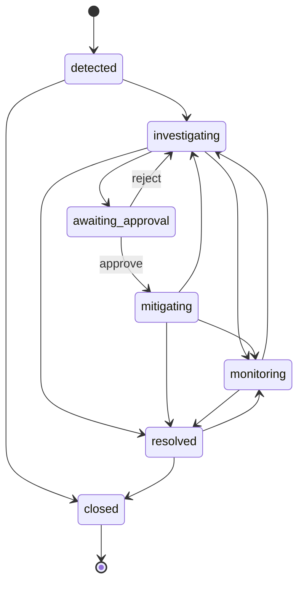

# Arquitetura do PulseOps AI

## Objetivos arquiteturais

1. manter regras de incidente fora do transporte HTTP;
2. trocar infraestrutura sem reescrever casos de uso;
3. tratar LLMs como dependências não determinísticas e não confiáveis;
4. tornar cada ação explicável, limitada e auditável;
5. preservar um modo local reproduzível sem esconder diferenças de produção.

## Contextos

| Contexto       | Responsabilidade                      | Exemplos                                |
| -------------- | ------------------------------------- | --------------------------------------- |
| Domain         | invariantes e transições              | state machine de incidente              |
| Application    | orquestra casos de uso e ports        | `IncidentService`, `IncidentRepository` |
| Infrastructure | implementa persistência e integrações | memory adapter, PostgreSQL/Drizzle      |
| AI             | provider port, tools e contratos      | Demo/OpenAI, JSON Schema, ToolExecutor  |
| Delivery       | HTTP, SSE, autenticação e UI          | Fastify routes, React                   |

## Regra de dependência

```text
delivery ──> application ──> domain
                 │
                 └──> ports <── infrastructure
```

O domínio não importa Fastify, Drizzle, OpenAI ou React. A API cria as dependências no composition root (`buildApp`) e injeta interfaces nos casos de uso/providers.

## State machine de incidentes



Transições inválidas retornam `422` com código de domínio. Toda transição válida acrescenta um evento à timeline.

## Persistência

`IncidentRepository` define paginação, busca, leitura, escrita, serviços e geração de ID. Existem dois adapters:

- `InMemoryIncidentRepository`: Demo Mode e testes rápidos;
- `PostgresIncidentRepository`: Drizzle + transação para incidente/timeline.

`DATA_BACKEND` seleciona o adapter. O health endpoint declara explicitamente o modo ativo e retorna `503` se PostgreSQL for obrigatório e estiver indisponível.

## Consistência e idempotência

- seed usa transação e `ON CONFLICT`;
- eventos têm IDs estáveis e `ON CONFLICT DO NOTHING`;
- reindexação retorna job ID e deve usar chave idempotente;
- BullMQ limita tentativas e usa exponential backoff;
- propostas de remediação não são executáveis.

## Streaming

SSE foi escolhido porque a investigação é um fluxo servidor → cliente. Cada evento possui ID e contrato Zod. O browser usa `AbortController`; o backend propaga o signal ao provider e às tools.

## Observabilidade

- logs JSON com campos sensíveis redigidos;
- request/correlation ID;
- duração e quantidade de tools por análise;
- status de conclusão/falha;
- health discriminando API, PostgreSQL e workers;
- auditoria de login, tools, incidentes e decisões humanas.

## Trade-offs atuais

- o adapter PostgreSQL cobre incidentes/serviços; métricas e logs permanecem sintéticos;
- busca lexical é usada no Demo Mode para reprodutibilidade;
- telemetria da IA vive na sessão do processo, não em série temporal persistente;
- o produto é single-tenant.

Esses limites estão documentados para evitar que um mecanismo demonstrativo seja apresentado como integração de produção.
