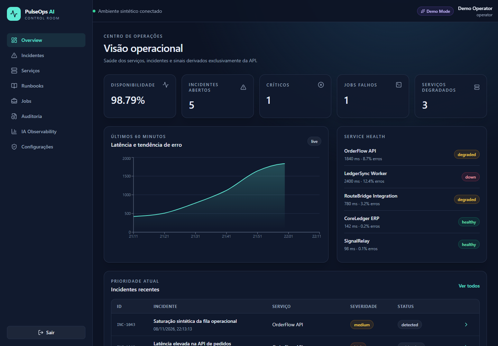
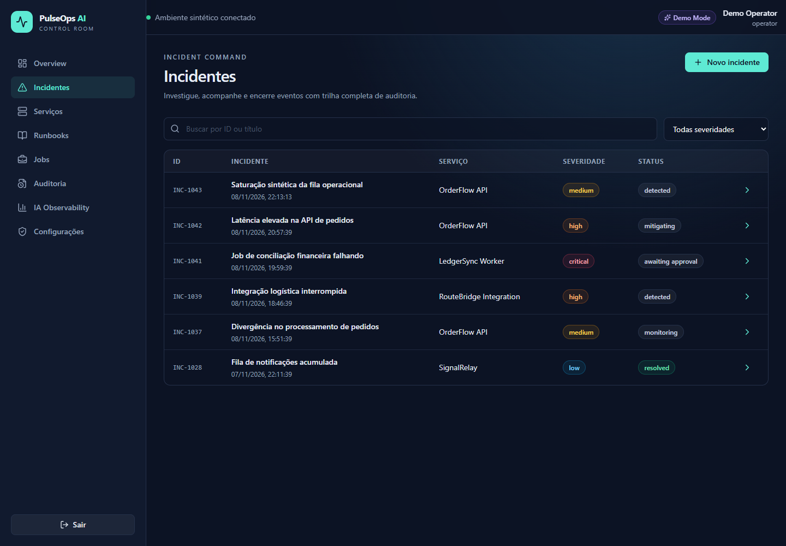
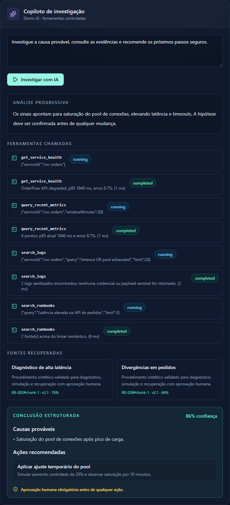
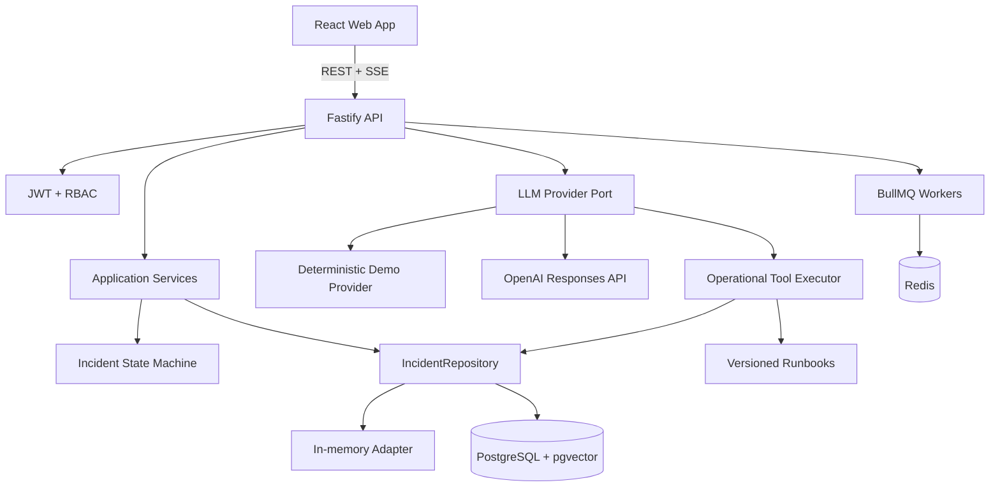
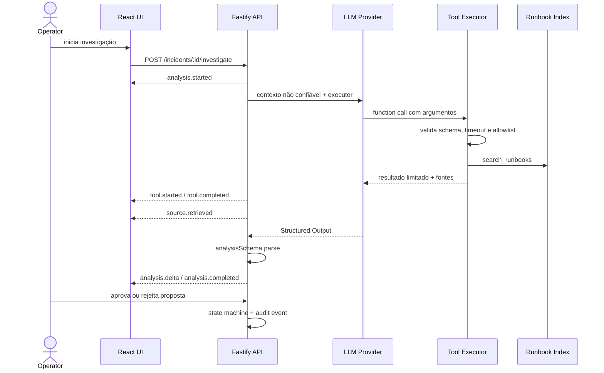

<div align="center">

# PulseOps AI

### Operational Intelligence Copilot

**Investigação operacional orientada por evidências, com LLM, RAG, tools controladas e aprovação humana.**

[](https://www.typescriptlang.org/)
[](https://react.dev/)
[](https://fastify.dev/)
[](https://github.com/pgvector/pgvector)
[](#qualidade-e-testes)

[Produto](#produto-em-ação) · [Quick start](#quick-start) · [Arquitetura](#arquitetura) · [Fluxo de IA](#fluxo-de-investigação-com-ia) · [Segurança](#segurança) · [Demo](#roteiro-de-demo-em-5-minutos)

</div>

---



<p align="center">
  <sub>Dashboard real do Demo Mode: saúde dos serviços, SLOs, latência, erros, incidentes e jobs em uma única visão.</sub>
</p>

## Visão executiva

O **PulseOps AI** é uma plataforma de resposta a incidentes que transforma sinais operacionais dispersos em uma investigação explicável, segura e acionável. O operador acompanha o problema, pede uma análise ao copiloto, observa cada ferramenta consultada em tempo real, confere as fontes recuperadas e decide se a remediação proposta deve ser aprovada.

Este repositório foi construído como um produto completo — não como uma coleção de telas. Frontend, API, domínio, persistência, fila, IA e observabilidade possuem contratos claros e podem ser executados localmente sem credenciais externas.

### O que um recrutador consegue avaliar aqui

| Competência | Evidência no projeto |
| --- | --- |
| Construção de produto | Jornada coerente de login, monitoramento, incidente, investigação e aprovação |
| Full Stack TypeScript | Monorepo com React e Fastify compartilhando contratos Zod tipados |
| Engenharia de IA | Provider real, Demo Mode determinístico, Tool Calling, RAG, Structured Outputs e SSE |
| Arquitetura | Camadas de domínio, casos de uso, ports/adapters e state machine de incidentes |
| Segurança | RBAC, rate limiting, allowlist de tools, redação de segredos e human-in-the-loop |
| Qualidade | Testes unitários, integração, componentes, E2E, AI evals e pipeline de CI |
| Experiência operacional | Docker Compose, migrations, seed, health checks, logs e correlation ID |

### Diferenciais que vão além do CRUD

- **IA observável:** a interface revela tools, argumentos, duração, resultados, fontes e confiança; a resposta não aparece como uma caixa-preta.
- **Segurança por desenho:** o modelo não recebe shell nem SQL arbitrário e nenhuma recomendação mutável é executada automaticamente.
- **Demonstração reproduzível:** toda a jornada funciona sem chave de LLM e os testes nunca consomem APIs pagas.
- **Evolução realista:** adapters permitem alternar do ambiente em memória para PostgreSQL, pgvector, Redis e BullMQ sem mover regras de negócio para a infraestrutura.
- **Contratos verificáveis:** entradas, tools, eventos SSE e saídas estruturadas são validados no backend.

## Por que este projeto existe

Durante um incidente, sinais importantes ficam distribuídos entre métricas, logs, filas, histórico e documentação. A pressão por uma resposta rápida costuma competir com dois requisitos essenciais: **explicar a decisão** e **não permitir que automação sem supervisão altere o ambiente**.

O PulseOps AI concentra esse fluxo em um produto B2B fictício:

1. detecta e organiza incidentes;
2. consulta somente ferramentas registradas e validadas;
3. recupera runbooks e incidentes relacionados;
4. produz uma análise estruturada e citável;
5. transmite cada etapa por SSE;
6. transforma remediações em propostas não executáveis;
7. exige uma decisão humana auditável.

Todos os nomes, serviços, usuários, métricas, logs e incidentes são sintéticos. Este é um projeto autoral de portfólio, sem associação com empresas reais.

## Produto em ação

As imagens abaixo foram capturadas da aplicação em execução, usando apenas o ambiente sintético incluído no repositório.

### Incident Command

Filtros, severidade e estado operacional ajudam a priorizar a resposta. Cada incidente abre uma visão detalhada com timeline, evidências e ações permitidas pelo perfil do usuário.



### Investigação explicável com IA

O streaming mostra a análise enquanto ela acontece. Chamadas de ferramentas e fontes RAG permanecem visíveis, e a conclusão validada inclui confiança e a exigência de aprovação humana.

<p align="center">
  
</p>

> [!NOTE]
> As capturas podem ser regeneradas contra a aplicação local com `pnpm capture:screenshots`. Isso mantém a documentação alinhada ao produto entregue.

## O que demonstra

| Área               | Implementação                                                                   |
| ------------------ | ------------------------------------------------------------------------------- |
| Frontend           | React 19, TypeScript strict, React Router, TanStack Query, Tailwind e Recharts  |
| Backend            | Fastify 5, API REST versionada, Zod, JWT/cookie, RBAC e Pino                    |
| Domínio            | Casos de uso, repository pattern e state machine de incidentes                  |
| IA                 | Provider port, Demo provider determinístico e OpenAI Responses API              |
| Tool Calling       | 10 tools em allowlist, schemas Zod, timeout, auditoria e resultados limitados   |
| Structured Outputs | JSON Schema no provider real + revalidação Zod no backend                       |
| Streaming          | SSE tipado, IDs de evento, cancelamento e proteção contra duplicidade           |
| RAG                | Runbooks Markdown, chunks citáveis, busca determinística e schema pgvector/HNSW |
| Persistência       | Adapter em memória para Demo Mode e adapter PostgreSQL/Drizzle para incidentes  |
| Assíncrono         | BullMQ/Redis com retry, exponential backoff, concorrência e falhas preservadas  |
| Qualidade          | Vitest, Testing Library, Playwright, avaliação de IA e GitHub Actions           |

## Produto

### Superfícies entregues

- login com perfis `admin`, `operator` e `viewer`;
- dashboard com disponibilidade, latência, erros, incidentes e jobs;
- criação, filtro, paginação, detalhe e transição de incidentes;
- timeline de eventos e trilha de auditoria;
- copiloto contextual dentro do incidente;
- visualização das tools, argumentos, duração e resultados resumidos;
- fontes RAG com documento, trecho, versão, ID e similaridade;
- decisão humana de aprovação ou rejeição;
- catálogo de serviços e runbooks;
- monitoramento de filas/jobs;
- observabilidade da IA baseada nas execuções da sessão;
- Swagger/OpenAPI e health endpoint.

### Fluxo demonstrável

```text
login → dashboard → incidente → investigação SSE
      → tools validadas → fontes RAG → análise estruturada
      → proposta sem execução → aprovação humana → auditoria
```

## Arquitetura



### Dependências entre camadas

```text
HTTP routes ──> application services ──> domain
                      │
                      └──> repository port <── infrastructure adapters

investigation route ──> LLM provider port ──> controlled tool executor
```

As regras de transição não vivem no handler HTTP. O armazenamento é selecionado por `DATA_BACKEND`, e providers de IA recebem um executor de tools por injeção. Isso mantém regras de negócio, transporte, infraestrutura e modelo desacoplados.

Mais detalhes: [ARCHITECTURE.md](./ARCHITECTURE.md) e [AI_DESIGN.md](./AI_DESIGN.md).

## Fluxo de investigação com IA



### Tools disponíveis

| Tool                     | Tipo        | Proteção principal                               |
| ------------------------ | ----------- | ------------------------------------------------ |
| `get_service_health`     | leitura     | somente `serviceId` registrado                   |
| `query_recent_metrics`   | leitura     | janela entre 1 e 1440 minutos                    |
| `search_logs`            | leitura     | consulta ≤ 200 caracteres; máximo 100 resultados |
| `get_failed_jobs`        | leitura     | fila opcional; resultado limitado                |
| `get_integration_events` | leitura     | serviço registrado; resultado limitado           |
| `search_runbooks`        | leitura/RAG | top-k ≤ 10 e limiar mínimo                       |
| `find_similar_incidents` | leitura     | incidente existente; top-k ≤ 10                  |
| `get_incident_timeline`  | leitura     | timeline auditável                               |
| `propose_remediation`    | proposta    | `executable: false` e aprovação obrigatória      |
| `simulate_remediation`   | simulação   | zero mutações operacionais                       |

Não existe tool para shell, filesystem, SQL arbitrário, URL livre ou execução remota.

### Eventos SSE

```text
analysis.started
tool.started
tool.completed
source.retrieved
analysis.delta
analysis.completed | analysis.failed
```

O cliente usa `AbortController`, descarta IDs duplicados e não precisa esperar a análise completa para atualizar a interface.

## Demo Mode e Real AI Mode

### Demo Mode — padrão

- não exige chave;
- executa as mesmas tools do fluxo real;
- usa dados sintéticos determinísticos;
- produz streaming reproduzível;
- é usado por testes e avaliação;
- aparece explicitamente como `Demo Mode` na interface.

### OpenAI provider

Com `LLM_PROVIDER=openai`, o backend usa a Responses API em duas etapas:

1. o modelo seleciona functions estritas;
2. o backend valida e executa cada tool;
3. outputs são devolvidos pelo respectivo `call_id`;
4. a resposta final usa JSON Schema estrito;
5. Zod revalida a estrutura antes do frontend.

O provider usa `store: false`, timeout, cancelamento e retry limitado. Testes automatizados nunca chamam API paga.

## Quick start

### Opção A — Demo Mode sem infraestrutura

Requisitos: Node.js 24+ e pnpm 10+.

```bash
corepack enable
pnpm install
pnpm dev
```

| Serviço  | URL                          |
| -------- | ---------------------------- |
| Frontend | http://localhost:5173        |
| API      | http://localhost:3333        |
| Swagger  | http://localhost:3333/docs   |
| Health   | http://localhost:3333/health |

Nesse modo, `DATA_BACKEND=memory` e `LLM_PROVIDER=demo` são aplicados por padrão.

### Opção B — stack completa com Docker

```bash
cp .env.example .env
docker compose up -d --build
docker compose ps
```

O Compose inicializa pgvector, Redis, migration, seed, API, workers e web. O frontend fica em http://localhost:8080.

### Banco local sem Compose

```bash
docker compose up -d postgres redis
pnpm db:migrate
pnpm db:seed
DATA_BACKEND=postgres pnpm dev
```

No PowerShell:

```powershell
$env:DATA_BACKEND = "postgres"
pnpm dev
```

## Configuração

| Variável         |                 Default | Obrigatória | Descrição                                        |
| ---------------- | ----------------------: | :---------: | ------------------------------------------------ |
| `NODE_ENV`       |           `development` |     não     | ambiente do Node                                 |
| `PORT`           |                  `3333` |     não     | porta da API                                     |
| `WEB_ORIGIN`     | `http://localhost:5173` |  produção   | origem CORS permitida                            |
| `DATA_BACKEND`   |                `memory` |     não     | `memory` ou `postgres`                           |
| `DATABASE_URL`   |                   local | PostgreSQL  | conexão do pgvector                              |
| `REDIS_URL`      |                   local |   workers   | conexão BullMQ                                   |
| `ENABLE_WORKERS` |                 `false` |     não     | ativa workers BullMQ                             |
| `SESSION_SECRET` |            valor de dev |  produção   | mínimo de 32 caracteres                          |
| `LLM_PROVIDER`   |                  `demo` |     não     | `demo` ou `openai`                               |
| `OPENAI_API_KEY` |                   vazio |   Real AI   | chave lida somente no backend                    |
| `OPENAI_MODEL`   |           `gpt-4o-mini` |     não     | modelo com function calling e Structured Outputs |

Copie [.env.example](./.env.example). O `.gitignore` bloqueia `.env` e variantes; credenciais nunca devem ser commitadas.

## Autenticação e perfis

| Perfil     | Capacidades                                                                        |
| ---------- | ---------------------------------------------------------------------------------- |
| `viewer`   | dashboard, serviços, incidentes, runbooks e jobs                                   |
| `operator` | capacidades de viewer + criar/alterar incidentes, investigar e decidir remediações |
| `admin`    | capacidades de operator + auditoria, observabilidade e reindexação                 |

Credenciais sintéticas:

| Perfil   | E-mail                    | Senha      |
| -------- | ------------------------- | ---------- |
| Operator | `operator@pulseops.local` | `Demo123!` |
| Viewer   | `viewer@pulseops.local`   | `Demo123!` |
| Admin    | `admin@pulseops.local`    | `Demo123!` |

As senhas são comparadas com bcrypt também no adapter de demonstração.

## API

Todas as rotas de domínio usam `/api/v1`. Exemplos:

```bash
# Login
curl -X POST http://localhost:3333/api/v1/auth/login \
  -H "content-type: application/json" \
  -d '{"email":"operator@pulseops.local","password":"Demo123!"}'

# Criar incidente
curl -X POST http://localhost:3333/api/v1/incidents \
  -H "authorization: Bearer <token>" \
  -H "content-type: application/json" \
  -d '{
    "title":"Saturação sintética na fila",
    "description":"O backlog excedeu o limite operacional por dez minutos.",
    "severity":"high",
    "serviceId":"svc-orders"
  }'
```

Formato de erro:

```json
{
  "error": "Transition from detected to resolved is not allowed",
  "requestId": "6b6d5e91-..."
}
```

Explore contratos e respostas em http://localhost:3333/docs.

## Segurança

- autorização server-side em todas as rotas protegidas;
- cookie `httpOnly`, `sameSite=lax` e `secure` em produção;
- bcrypt para senhas;
- rate limit global e específico para login/investigação;
- Helmet, CORS restrito e limite de payload;
- Zod em entradas, tool arguments, eventos e saída da IA;
- allowlist de tools com timeout e limites de resultado;
- Pino com redaction de authorization, cookie, senha e chave;
- `requestId` e `correlationId` em operações auditáveis;
- documentos, logs e mensagens tratados como dados não confiáveis;
- nenhum chain of thought exibido;
- remediações são propostas/simulações, nunca execução direta.

Threat model e controles complementares: [SECURITY.md](./SECURITY.md).

## Qualidade e testes

```bash
pnpm lint          # ESLint, zero warnings permitido
pnpm typecheck     # TypeScript strict em todos os workspaces
pnpm test          # domínio, API, tools, IA e componentes
pnpm test:e2e      # fluxo operator → investigação → aprovação
pnpm build         # build de produção de todos os pacotes
pnpm eval          # avaliação determinística do copiloto
```

A suíte cobre, entre outros:

- autenticação e credenciais inválidas;
- RBAC;
- criação de incidentes;
- state machine e transições inválidas;
- validação/execução das tools;
- citações RAG;
- Structured Output;
- streaming SSE;
- cancelamento;
- resistência a tool fora da allowlist;
- fluxo E2E completo sem API paga.

O relatório de avaliação é salvo em [`apps/api/eval-report.json`](./apps/api/eval-report.json). Nenhum percentual é declarado sem uma execução correspondente.

## Estrutura

```text
.
├── apps
│   ├── api
│   │   ├── migrations
│   │   └── src
│   │       ├── application    # casos de uso, ports e tool executor
│   │       ├── domain         # regras e state machine
│   │       ├── infrastructure # adapters memory/PostgreSQL
│   │       ├── db             # Drizzle, migration e seed
│   │       └── eval           # avaliação do copiloto
│   └── web                    # React, rotas, queries e SSE
├── packages
│   ├── ai                     # provider port, OpenAI/Demo e schemas de tools
│   ├── config                 # ambiente validado
│   └── contracts              # contratos Zod compartilhados
├── knowledge/runbooks         # base Markdown fictícia
├── e2e                         # Playwright
└── .github/workflows          # CI
```

## Decisões e trade-offs

| Decisão                  | Motivo                                      | Trade-off                                                 |
| ------------------------ | ------------------------------------------- | --------------------------------------------------------- |
| SSE em vez de WebSocket  | fluxo unidirecional, simples e observável   | não atende colaboração bidirecional persistente           |
| Provider port            | troca Demo/OpenAI sem alterar rotas         | exige normalização de capacidades entre providers         |
| Repository port          | testes rápidos e PostgreSQL sem acoplamento | dois adapters precisam obedecer aos mesmos contract tests |
| Demo Mode determinístico | zero custo e E2E reproduzível               | não mede qualidade de um modelo real                      |
| Structured Output + Zod  | defesa em profundidade                      | schema precisa evoluir de forma coordenada                |
| Human-in-the-loop        | impede autonomia operacional indevida       | adiciona latência à resposta ao incidente                 |

## Roteiro de demo em 5 minutos

1. Faça login como `operator` e mostre o indicador explícito de Demo Mode.
2. Mostre que dashboard e tabelas vêm da API/TanStack Query.
3. Crie um incidente e explique a state machine.
4. Abra `INC-1042` e inicie a investigação.
5. Mostre tools, argumentos validados, duração e citações.
6. Destaque confiança, limitações e Structured Output.
7. Aprove a remediação e confira o evento na timeline.
8. Entre como admin e abra Auditoria/IA Observability.

## Limitações conhecidas

- o Demo Mode usa busca lexical determinística; o schema pgvector está disponível para o modo PostgreSQL, mas um embedding provider externo exige configuração;
- autenticação PostgreSQL e gestão de usuários ainda não possuem tela administrativa;
- métricas/logs são sintéticos e não integram Prometheus, OpenTelemetry ou um log store real;
- a aplicação é single-tenant;
- produção exigiria secret manager, TLS no edge, CSRF token adicional, SSO/MFA e política de retenção;
- o bundle web ainda pode ser reduzido com lazy loading por rota.

Essas limitações são deliberadamente documentadas: o projeto não apresenta simulação como integração real.

## Documentação técnica

- [ARCHITECTURE.md](./ARCHITECTURE.md) — fronteiras, componentes e decisões;
- [AI_DESIGN.md](./AI_DESIGN.md) — providers, tools, RAG e Structured Outputs;
- [SECURITY.md](./SECURITY.md) — threat model e controles;
- [DEMO.md](./DEMO.md) — roteiro de apresentação;
- [CONTRIBUTING.md](./CONTRIBUTING.md) — convenções e quality gates.

## Próximos passos

- contract tests compartilhados entre os adapters memory/PostgreSQL;
- embeddings locais no Demo Mode e OpenAI embeddings no modo real;
- OpenTelemetry + Prometheus;
- refresh token rotation e sessões revogáveis;
- componentização/lazy loading adicional no frontend;
- testes com Testcontainers em CI.

## Licença e uso

Distribuído sob a [licença MIT](./LICENSE). Projeto de portfólio com dados fictícios; não utilize as credenciais Demo em produção.
