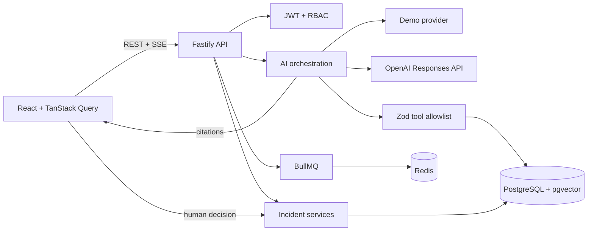

# PulseOps AI — Operational Intelligence Copilot

Plataforma Full Stack autoral de inteligência operacional com dados exclusivamente sintéticos. O PulseOps AI transforma sinais de serviços, integrações e jobs em investigações auditáveis com LLM, tool calling controlado, RAG, streaming e aprovação humana.

> **Demo Mode é o padrão:** o sistema funciona sem chave externa e identifica claramente respostas determinísticas. Nenhuma organização real, dado confidencial ou ação operacional é usada.

## O problema que resolve

Equipes operacionais precisam correlacionar métricas, logs, jobs e procedimentos sob pressão. O PulseOps AI reúne esse contexto, evidencia cada ferramenta/fonte usada e produz uma análise estruturada sem conceder à IA acesso a shell, SQL arbitrário ou mutações não aprovadas.

## Funcionalidades

- Login e RBAC (`admin`, `operator`, `viewer`) com autorização no backend.
- Dashboard calculado pela API: disponibilidade, latência, erros, incidentes e jobs.
- Incidentes com filtros, detalhe, SLA, timeline e auditoria.
- Copiloto com SSE real, cancelamento, tools visíveis, fontes e saída Zod.
- Providers `DemoLLMProvider` e `OpenAILLMProvider` (Responses API).
- RAG com Markdown versionado, embeddings e `pgvector`.
- BullMQ/Redis para filas de ingestão e análise; painel de jobs.
- Aprovação/rejeição humana antes da remediação simulada.
- Swagger, logs JSON, IDs de correlação, redaction e rate limiting.
- Vitest, React Testing Library, Playwright e avaliação de IA.

## Arquitetura



Detalhes em [ARCHITECTURE.md](./ARCHITECTURE.md), [AI_DESIGN.md](./AI_DESIGN.md) e [SECURITY.md](./SECURITY.md).

## Stack

React 19, TypeScript strict, Vite, Tailwind, TanStack Query, Recharts; Node.js, Fastify, Zod, Drizzle; PostgreSQL/pgvector; Redis/BullMQ; OpenAI SDK; Vitest, RTL e Playwright; Docker Compose e GitHub Actions.

## Execução local

Requisitos: Node.js 24+, pnpm 10+ e Docker com Compose.

```bash
cp .env.example .env
pnpm install
docker compose up -d postgres redis
pnpm db:migrate
pnpm db:seed
pnpm --filter @pulseops/api dev
pnpm --filter @pulseops/web dev
```

Web: `http://localhost:5173` · API: `http://localhost:3333` · Swagger: `http://localhost:3333/docs` · Health: `http://localhost:3333/health`.

Ou suba tudo: `docker compose up -d --build` e abra `http://localhost:8080`.

## Variáveis de ambiente

| Variável | Padrão | Uso |
|---|---|---|
| `LLM_PROVIDER` | `demo` | `demo` ou `openai` |
| `OPENAI_API_KEY` | vazio | Necessária somente no modo real |
| `OPENAI_MODEL` | `gpt-4o-mini` | Modelo com Structured Outputs |
| `DATABASE_URL` | local | PostgreSQL + pgvector |
| `REDIS_URL` | local | BullMQ |
| `SESSION_SECRET` | desenvolvimento | Trocar em produção |
| `WEB_ORIGIN` | localhost | CORS restritivo |

Nunca versione `.env` ou chaves.

## Tool Calling, streaming e RAG

A allowlist contém `get_service_health`, `query_recent_metrics`, `search_logs`, `get_failed_jobs`, `get_integration_events`, `search_runbooks`, `find_similar_incidents`, `get_incident_timeline`, `propose_remediation` e `simulate_remediation`. Argumentos são validados por Zod e não aceitam shell, SQL ou URL arbitrária.

O endpoint envia eventos SSE `analysis.started`, `analysis.delta`, `tool.started`, `tool.completed`, `source.retrieved`, `analysis.completed` e `analysis.failed`. Cancelar a requisição aciona `AbortController` no provider.

Runbooks são fragmentados com metadados; a migration cria `vector(1536)` e índice HNSW. Citações incluem documento, trecho, versão, ID e similaridade. O provider OpenAI usa Responses API, `store: false`, timeout, retry limitado e JSON Schema estrito. Documentação oficial: [Function calling](https://developers.openai.com/api/docs/guides/function-calling), [Structured Outputs](https://developers.openai.com/api/docs/guides/structured-outputs?api-mode=responses) e [Streaming](https://developers.openai.com/api/docs/guides/streaming-responses).

## Testes e qualidade

```bash
pnpm lint
pnpm -r typecheck
pnpm test
pnpm -r build
pnpm eval
pnpm test:e2e
```

Testes usam apenas Demo Mode. O relatório de avaliação é gerado em `apps/api/eval-report.json`.

## Credenciais fictícias

- Operador: `operator@pulseops.local` / `Demo123!`
- Viewer: `viewer@pulseops.local` / `Demo123!`
- Admin: `admin@pulseops.local` / `Demo123!`

## Demo de cinco minutos

1. Entre como operador e apresente o dashboard vindo da API.
2. Abra `INC-1042` e percorra timeline/SLA.
3. Inicie a investigação e mostre SSE, tools e citações.
4. Explique saída estruturada, confiança e limitações.
5. Aprove/rejeite a proposta e confira a Auditoria como admin.

## Limitações

- Dados e remediações são deliberadamente sintéticos.
- O provider real exige chave e acesso ao modelo; testes nunca o acionam.
- Demo Mode usa cenários determinísticos para reprodutibilidade.
- Produção exige secret manager, TLS, SSO, retenção e observabilidade externa.

Descrição para GitHub: **Full Stack operational intelligence platform built with React, TypeScript and Node.js, featuring LLM tool calling, structured outputs, streaming, RAG, pgvector, queues, auditability and human-approved remediation workflows.**

Tópicos: `react`, `typescript`, `fastify`, `llm`, `rag`, `pgvector`, `bullmq`, `sse`, `operational-intelligence`.
